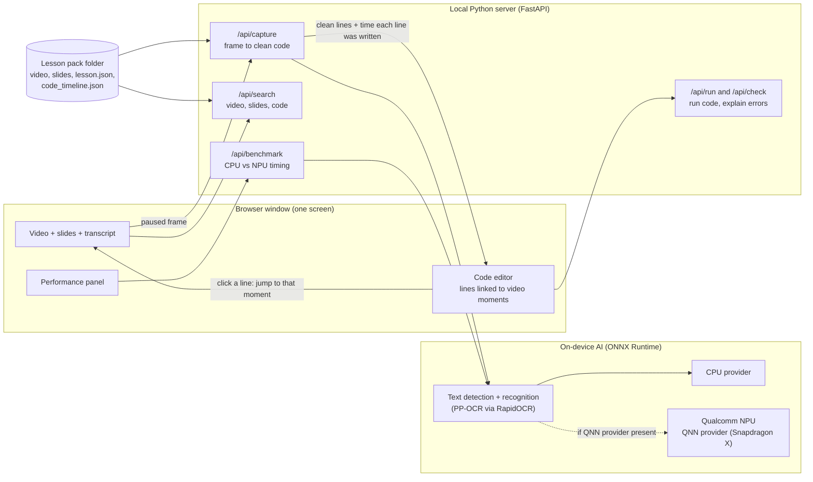

# Architecture

Everything runs on the student's laptop. There are no cloud calls.

## Where the NPU is used

| Task | Model | Runs through | NPU status |
|---|---|---|---|
| Read code from a video frame | PP-OCR detect + recognise (ONNX) | ONNX Runtime; QNN provider if present | Wired up and selectable. Not yet measured on a Snapdragon laptop. The models are not yet quantised or compiled for the NPU, so some operators may fall back to the CPU. |
| Transcript from video | Whisper | not built | Planned: Whisper from Qualcomm AI Hub on the NPU. `tools/transcribe.py` is an untested CPU starting point. |
| Search across lesson | TF-IDF (scikit-learn) | CPU | Planned: on-device embedding model from Qualcomm AI Hub. |
| Explain this error | Rule table + lesson search | CPU | Planned: small on-device LLM. |

The app never assumes the NPU is used. `/api/hardware` reports the execution providers each ONNX session was created with, and the panel shows them.

## Two-way link between video and code

1. `tools/index_video.py` OCRs the video and records when each line of code first appears: `code_timeline.json`.
2. When a student captures a frame, each captured line is matched to that timeline. The line gets a chip with the time the teacher wrote it.
3. Clicking the chip jumps the video to that moment. Clicking a transcript line or search result jumps the video too.

## Lesson pack

A folder in `lessons/`: `lesson.json` (transcript, slides, chapters, checkpoints, capture area), `video.mp4`, `slides/*.png`, `code_timeline.json`. Authoring tools for teachers are on the roadmap.
